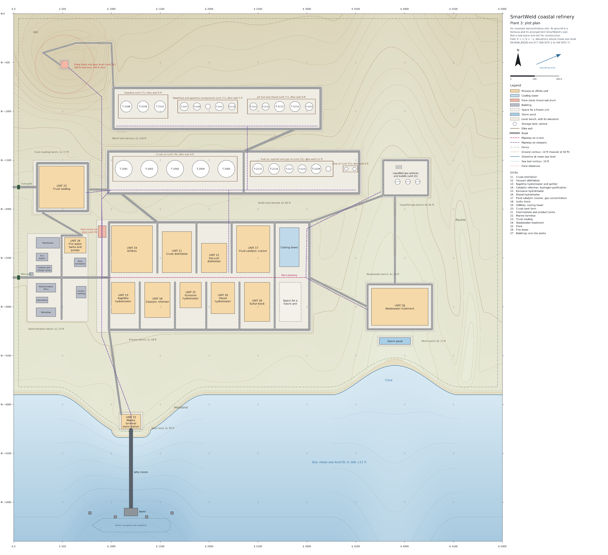
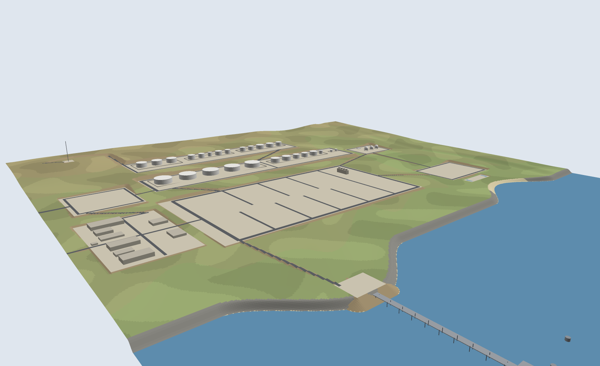

# Plant 3, the coastal refinery: site and plot plan

Generated by `tools/refinery-site.ts` from `src/refinery/terrain.ts` and `src/refinery/site.ts`; do not edit by hand. Rules: DESIGN_BASIS.md §77 (`SW-SITE-*`).

**What this is.** The ground the refinery stands on and where everything goes on it. The site is invented: its shoreline and contours are a formula, drawn after the kind of coast the owner chose (rock headland, cove, large tide, ground rising inland) and after no real place. No map, chart, survey or elevation data was used. The arrangement and the spacings are SmartWeld's own, each with its reason in the design basis, and are for the owner to review.

Feet throughout. Plant coordinates are E = x and N = −z from the north-west corner of the property; elevations are above the model's mean sea level.

## 1. The ground

The property is 5,000 ft east to west and 5,400 ft north to south, the southern part of it water (SW-SITE-1). The shoreline runs east–west about 3,900 ft south of the north boundary, with a headland pushed 420 ft seaward in the south-west and a cove drawn 300 ft inland in the south-east (SW-SITE-2). Behind a rock bank of 38 ft (10 ft at the cove's beach) a plateau climbs inland at 1.5 % and then at 4.5 %; a hill stands in the north-west corner and a ravine runs down the east side to the cove. The tide ranges 11 ft either side of mean sea level.

| Place | Natural ground, ft |
|---|---|
| North-west hill, at the flare (E 520, N −520) | 192 |
| North boundary, middle (E 2,500, N −50) | 153 |
| Middle of the north tank terrace (E 2,080, N −970) | 109 |
| Middle of the south tank terrace (E 2,250, N −1,625) | 82 |
| Middle of the process bench (E 1,950, N −2,685) | 53 |
| Top of the bank at the headland (E 1,200, N −4,200) | 39 |
| Top of the bank at the cove (E 3,900, N −3,520) | 10 |
| Ravine, half way down (E 4,620, N −2,400) | 37 |
| Sea bed at the berth (E 1,200, N −5,160) | -76 |

## 2. Benches

Each area stands on a level bench cut and filled into the natural ground with slopes of 2 to 1; its elevation is the mean of the natural ground over it, so cut about balances fill (SW-SITE-3).

| Bench | East, ft | North, ft | Size, ft | Elevation, ft | Natural ground under it, ft |
|---|---|---|---|---|---|
| Process bench | 850 to 3,050 | −3,260 to −2,110 | 2,200 × 1,150 | 58 | 45 to 76 |
| South tank terrace | 940 to 3,560 | −1,860 to −1,390 | 2,620 × 470 | 84 | 52 to 110 |
| North tank terrace | 1,000 to 3,160 | −1,200 to −740 | 2,160 × 460 | 116 | 96 to 147 |
| Liquefied gas bench | 3,760 to 4,260 | −1,880 to −1,480 | 500 × 400 | 45 | 37 to 66 |
| Wastewater bench | 3,600 to 4,300 | −3,250 to −2,750 | 700 × 500 | 23 | 13 to 39 |
| Administration bench | 140 to 760 | −3,150 to −2,250 | 620 × 900 | 55 | 48 to 65 |
| Truck loading bench | 200 to 780 | −2,050 to −1,500 | 580 × 550 | 77 | 64 to 97 |
| Flare pad | 470 to 570 | −570 to −470 | 100 × 100 | 192 | 188 to 194 |
| Jetty head | 1,080 to 1,320 | −4,260 to −4,080 | 240 × 180 | 39 | 27 to 42 |
| Storm pond | 3,720 to 4,080 | −3,400 to −3,300 | 360 × 100 | 15 | 12 to 19 |

Earth moved to make the benches and roads: about 860 thousand cubic yards cut and 825 thousand filled.

## 3. Plots

Where each unit and building stands, and why there (SW-SITE-4): process units on both sides of the main pipeway, each with its battery limit at the pipeway; utilities upwind at the west end and the cooling tower downwind at the east; the sulfur block downwind of the other units; buildings upwind at the west boundary; wastewater at the low south-east where drains reach it by gravity; the flare on the hill; the jetty off the headland, where deep water is close.

| Plot | Unit | Stands on | East, ft | North, ft | Size, ft | Elevation, ft |
|---|---|---|---|---|---|---|
| Utilities (battery limit on its south side) | 19 | Process bench | 1,000 to 1,420 | −2,650 to −2,170 | 420 × 480 | 58 |
| Crude distillation (battery limit on its south side) | 11 | Process bench | 1,520 to 1,820 | −2,650 to −2,230 | 300 × 420 | 58 |
| Vacuum distillation (battery limit on its south side) | 12 | Process bench | 1,920 to 2,180 | −2,650 to −2,350 | 260 × 300 | 58 |
| Fluid catalytic cracker (battery limit on its south side) | 17 | Process bench | 2,280 to 2,620 | −2,650 to −2,170 | 340 × 480 | 58 |
| Cooling tower | 19 | Process bench | 2,720 to 2,920 | −2,590 to −2,190 | 200 × 400 | 58 |
| Naphtha hydrotreater (battery limit on its north side) | 13 | Process bench | 1,000 to 1,240 | −3,070 to −2,750 | 240 × 320 | 58 |
| Catalytic reformer (battery limit on its north side) | 14 | Process bench | 1,340 to 1,600 | −3,110 to −2,750 | 260 × 360 | 58 |
| Kerosene hydrotreater (battery limit on its north side) | 15 | Process bench | 1,700 to 1,920 | −3,010 to −2,750 | 220 × 260 | 58 |
| Diesel hydrotreater (battery limit on its north side) | 16 | Process bench | 2,020 to 2,260 | −3,070 to −2,750 | 240 × 320 | 58 |
| Sulfur block (battery limit on its north side) | 18 | Process bench | 2,360 to 2,620 | −3,150 to −2,750 | 260 × 400 | 58 |
| Space for a future unit |  | Process bench | 2,720 to 2,940 | −3,150 to −2,750 | 220 × 400 | 58 |
| Truck loading | 23 | Truck loading bench | 260 to 720 | −1,990 to −1,560 | 460 × 430 | 77 |
| Wastewater treatment | 24 | Wastewater bench | 3,660 to 4,240 | −3,190 to −2,810 | 580 × 380 | 23 |
| Flare stack and seal drum | 25 | Flare pad | 480 to 560 | −560 to −480 | 80 × 80 | 192 |
| Flare knock-out drum | 25 | Process bench | 865 to 945 | −2,290 to −2,170 | 80 × 120 | 58 |
| Marine terminal shore station | 22 | Jetty head | 1,100 to 1,300 | −4,250 to −4,100 | 200 × 150 | 39 |
| Storm pond | 24 | Storm pond | 3,740 to 4,060 | −3,385 to −3,315 | 320 × 70 | 15 |
| Fire water tanks and pumps | 26 | Administration bench | 520 to 740 | −2,450 to −2,290 | 220 × 160 | 55 |
| Gatehouse | 27 | Administration bench | 160 to 200 | −2,680 to −2,650 | 40 × 30 | 55 |
| Warehouse | 27 | Administration bench | 230 to 470 | −2,400 to −2,290 | 240 × 110 | 55 |
| Fire station | 27 | Administration bench | 230 to 350 | −2,530 to −2,450 | 120 × 80 | 55 |
| Canteen and change house | 27 | Administration bench | 230 to 390 | −2,645 to −2,575 | 160 × 70 | 55 |
| Administration office | 27 | Administration bench | 230 to 430 | −2,850 to −2,760 | 200 × 90 | 55 |
| Laboratory | 27 | Administration bench | 230 to 350 | −2,960 to −2,900 | 120 × 60 | 55 |
| Workshop | 27 | Administration bench | 230 to 430 | −3,100 to −3,010 | 200 × 90 | 55 |
| Main substation | 27 | Administration bench | 620 to 740 | −2,590 to −2,500 | 120 × 90 | 55 |
| Control building | 27 | Administration bench | 640 to 740 | −2,910 to −2,790 | 100 × 120 | 55 |

## 4. Tanks

Tanks of one kind of stock stand in a row in one dike. A dike holds 1.1 × its largest tank within a wall of 6 ft at most, and is widened beyond the toe clearance where the wall would otherwise be higher (SW-SITE-5, SW-CIV-14).

| Dike | Unit | Terrace | Inside, ft | Wall, ft | Holds, thousand bbl | Needs, thousand bbl | Tanks |
|---|---|---|---|---|---|---|---|
| Crude oil | 20 | South tank terrace, EL 84 | 1,273 × 255 | 6 | 218 | 217 | 5 |
| Fuel oil, asphalt and gas oil | 21 | South tank terrace, EL 84 | 848 × 158 | 5.5 | 92 | 85 | 6 |
| Slop oil | 21 | South tank terrace, EL 84 | 150 × 65 | 3 | 4 | 4 | 2 |
| Gasoline | 21 | North tank terrace, EL 116 | 508 × 241 | 6 | 98 | 97 | 3 |
| Naphthas and gasoline components | 21 | North tank terrace, EL 116 | 613 × 133 | 5 | 53 | 53 | 5 |
| Jet fuel and diesel | 21 | North tank terrace, EL 116 | 696 × 153 | 6 | 80 | 79 | 5 |

| Tank | Centre | Diameter × height, ft | Base elevation, ft |
|---|---|---|---|
| T-2001 | E 1,126, N −1,588 | 175 × 48 | 84 |
| T-2002 | E 1,388, N −1,588 | 175 × 48 | 84 |
| T-2003 | E 1,651, N −1,588 | 175 × 48 | 84 |
| T-2004 | E 1,913, N −1,588 | 175 × 48 | 84 |
| T-2005 | E 2,176, N −1,588 | 175 × 48 | 84 |
| T-2115 | E 2,499, N −1,588 | 110 × 48 | 84 |
| T-2116 | E 2,664, N −1,588 | 110 × 48 | 84 |
| T-2117 | E 2,817, N −1,588 | 85 × 48 | 84 |
| T-2118 | E 2,952, N −1,588 | 85 × 48 | 84 |
| T-2104 | E 3,094, N −1,588 | 100 × 48 | 84 |
| T-2119 | E 3,219, N −1,588 | 50 × 40 | 84 |
| T-2120 | E 3,403, N −1,588 | 35 × 24 | 84 |
| T-2121 | E 3,488, N −1,588 | 35 × 24 | 84 |
| T-2108 | E 1,152, N −950 | 115 × 48 | 116 |
| T-2109 | E 1,324, N −950 | 115 × 48 | 116 |
| T-2110 | E 1,497, N −950 | 115 × 48 | 116 |
| T-2107 | E 1,745, N −950 | 85 × 48 | 116 |
| T-2106 | E 1,875, N −950 | 75 × 48 | 116 |
| T-2105 | E 1,987, N −950 | 50 × 48 | 116 |
| T-2101 | E 2,105, N −950 | 85 × 48 | 116 |
| T-2102 | E 2,232, N −950 | 70 × 48 | 116 |
| T-2111 | E 2,453, N −950 | 75 × 48 | 116 |
| T-2112 | E 2,578, N −950 | 75 × 48 | 116 |
| T-2113 | E 2,720, N −950 | 105 × 48 | 116 |
| T-2114 | E 2,878, N −950 | 105 × 48 | 116 |
| T-2103 | E 3,023, N −950 | 80 × 48 | 116 |
| S-2101 | E 3,927, N −1,720 | 54 sphere | 45 |
| S-2102 | E 4,033, N −1,720 | 50 sphere | 45 |
| S-2103 | E 4,133, N −1,720 | 50 sphere | 45 |
| S-2104 | E 3,940, N −1,560 | 10 diameter × 60 long, horizontal | 45 |
| S-2105 | E 3,940, N −1,580 | 10 diameter × 60 long, horizontal | 45 |

## 5. Roads

Primary roads 24 ft wide, secondary 20 ft, tracks 16 ft, at 6 % at most; ramps between benches run at one grade (SW-SITE-6).

| Road | Width, ft | Length, ft | From elevation, ft | To, ft | Steepest |
|---|---|---|---|---|---|
| Main road from the gate | 24 | 975 | 53 | 58 | 1.5 % |
| Process ring road | 24 | 6,300 | 58 | 58 | 0.0 % |
| Road between units | 20 | 515 | 58 | 58 | 0.0 % |
| Road between units | 20 | 515 | 58 | 58 | 0.0 % |
| Road between units | 20 | 515 | 58 | 58 | 0.0 % |
| Road between units | 20 | 485 | 58 | 58 | 0.0 % |
| Road between units | 20 | 485 | 58 | 58 | 0.0 % |
| Road between units | 20 | 485 | 58 | 58 | 0.0 % |
| Road between units | 20 | 485 | 58 | 58 | 0.0 % |
| Road across the pipeway | 20 | 1,100 | 58 | 58 | 0.0 % |
| Ramp to the south terrace | 24 | 473 | 58 | 84 | 5.5 % |
| South terrace road | 24 | 6,000 | 84 | 84 | 0.0 % |
| Road between the dikes | 20 | 430 | 84 | 84 | 0.0 % |
| Ramp to the north terrace | 24 | 575 | 84 | 116 | 5.6 % |
| North terrace road | 24 | 5,080 | 116 | 116 | 0.0 % |
| Road to the liquefied gas bench | 20 | 804 | 58 | 45 | 1.6 % |
| Liquefied gas bench road | 20 | 1,640 | 45 | 45 | 0.0 % |
| Road to the wastewater bench | 20 | 666 | 58 | 23 | 5.3 % |
| East road | 20 | 870 | 45 | 23 | 2.5 % |
| Wastewater bench road | 20 | 2,240 | 23 | 23 | 0.0 % |
| Road to the jetty | 20 | 874 | 58 | 39 | 2.2 % |
| Truck gate road | 24 | 240 | 74 | 77 | 1.4 % |
| Truck loading road | 24 | 2,020 | 77 | 77 | 0.0 % |
| Road from the offices to truck loading | 20 | 461 | 55 | 77 | 4.8 % |
| Administration road | 20 | 640 | 55 | 55 | 0.0 % |
| Administration road | 20 | 425 | 55 | 55 | 0.0 % |
| Road from truck loading to the tanks | 20 | 185 | 77 | 84 | 3.8 % |
| Track to the flare | 16 | 1,383 | 116 | 192 | 5.5 % |

Roads in all: 36,866 ft.

## 6. Pipeways

Where lines run between units and areas; the racks, sleepers and lines themselves are built in the piping stage.

| Pipeway | Carried on | Width, ft | Length, ft |
|---|---|---|---|
| Main pipeway | a pipe rack | 40 | 2,000 |
| Tank farm pipeway | sleepers at grade | 30 | 1,690 |
| South terrace pipe track | sleepers at grade | 24 | 2,510 |
| North terrace pipe track | sleepers at grade | 24 | 2,060 |
| Jetty pipeway | sleepers at grade | 30 | 2,545 |
| Jetty trestle | the trestle, over the water | 40 | 800 |
| Flare line | sleepers at grade | 12 | 2,388 |
| Liquefied gas lines | sleepers at grade | 16 | 1,350 |
| Wastewater lines | sleepers at grade | 16 | 711 |
| Truck loading lines | sleepers at grade | 16 | 251 |

The berth is 840 ft off the headland, in 65 ft of water at low tide; the trestle's deck is at elevation 32 ft, 21 ft above high water.

## 7. The plot checked against its rules

| Rule | What | Asks | Has | |
|---|---|---|---|---|
| SW-SITE-3 | Benches stand twice their difference in level apart (least margin) | at least 0 ft over | 34 ft | meets |
| SW-SITE-3 | Every plot lies on its bench | all | 27 of 27 | meets |
| SW-SITE-3 | Every dike lies on its terrace, 40 ft inside its edge | all | 6 of 6 | meets |
| SW-SITE-4 | The cooling tower stands east (downwind) of every process unit | at least 100 ft | 100 ft | meets |
| SW-SITE-4 | The tank terraces stand above the process bench (lower terrace) | above | 26 ft | meets |
| SW-SITE-4 | The liquefied gas bench lies below the tank terraces | below | 39 ft | meets |
| SW-SITE-4 | The wastewater bench lies below the process bench, so drains reach it by gravity | below | 35 ft | meets |
| SW-SITE-4 | The wastewater bench stands above the highest tide | above 11 ft | 23 ft elevation | meets |
| SW-SITE-4 | Flare to the nearest tank shell | at least 500 ft | 706 ft | meets |
| SW-SITE-4 | Flare to the nearest unit or building | at least 500 ft | 1,040 ft | meets |
| SW-SITE-4 | Flare to the property line | at least 500 ft | 520 ft | meets |
| SW-SITE-4 | Offices, laboratory, workshop, stores and fire station to the nearest process unit | at least 500 ft | 530 ft | meets |
| SW-SITE-4 | Control building to the nearest process unit | at least 250 ft | 260 ft | meets |
| SW-SITE-4 | Buildings stand west (upwind) of every process unit | all | 9 of 9 | meets |
| SW-SITE-4 | Water at the berth at low tide | at least 60 ft | 65 ft | meets |
| SW-SITE-4 | The berth from the shore | at most 900 ft | 840 ft | meets |
| SW-SITE-5 | Process unit to process unit | at least 100 ft | 100 ft | meets |
| SW-SITE-5 | Tank shell to tank shell, over what the rule asks (least margin) | half the larger diameter, 50 ft at least | 0 ft | meets |
| SW-SITE-5 | Tank shell to the toe of its dike, over what the rule asks (least margin) | half its height, 15 ft at least | 0 ft | meets |
| SW-CIV-14 | Each dike holds 1.1 × its largest tank within a wall of 6 ft at most (highest wall) | at most 6 ft | 6 ft | meets |
| SW-SITE-5 | Dike to dike | at least 100 ft | 100 ft | meets |
| SW-SITE-5 | Tank shell to the nearest process unit | at least 250 ft | 495 ft | meets |
| SW-SITE-5 | Sphere to sphere | one diameter | 0 ft over | meets |
| SW-SITE-5 | Spheres to the nearest tank, unit or building | at least 200 ft | 414 ft | meets |
| SW-SITE-5 | Process units and tanks to the property line | at least 200 ft | 842 ft | meets |
| SW-SITE-6 | Steepest road | at most 6 % | 6 % | meets |
| SW-SITE-6 | Process units with a road on two sides or more | all | 10 of 10 | meets |
| SW-SITE-6 | Fence inside the property line | 50 ft | 50 ft | meets |

28 of 28 checks met.

## 8. Images

| Image | View |
|---|---|
| `screenshots/refinery/site-plot-plan.png` | Plant 3: plot plan, with ground contours, benches, units, tanks, roads and pipeways |
| `screenshots/refinery/site-from-the-south-west.png` | Plant 3: the graded site from the south-west, over the headland and the jetty (tanks, buildings and jetty as massing; units not yet built) |
| `screenshots/refinery/site-from-the-south-east.png` | Plant 3: the graded site from the south-east, over the cove |
| `screenshots/refinery/site-from-the-north.png` | Plant 3: the graded site from the north, over the flare hill and the tank terraces |
| `screenshots/refinery/site-process-bench-and-terraces.png` | Plant 3: the process bench with the tank terraces rising behind it |
| `screenshots/refinery/site-jetty-and-headland.png` | Plant 3: the jetty trestle, berth and dolphins off the headland |

